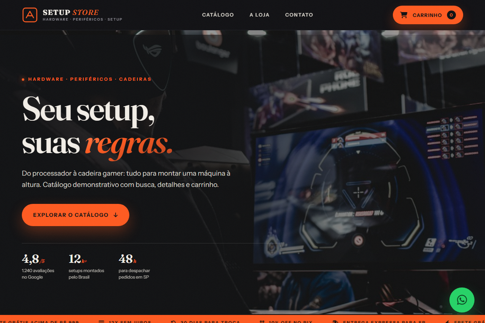
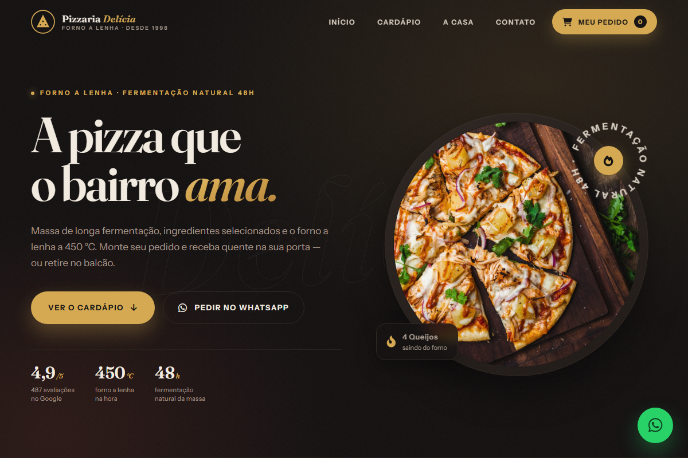
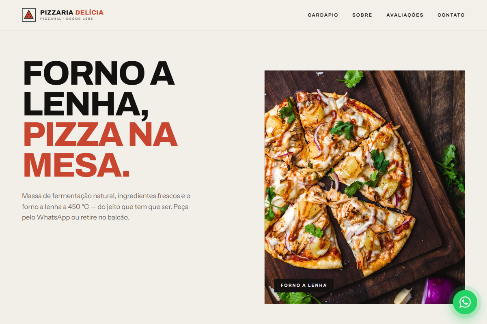
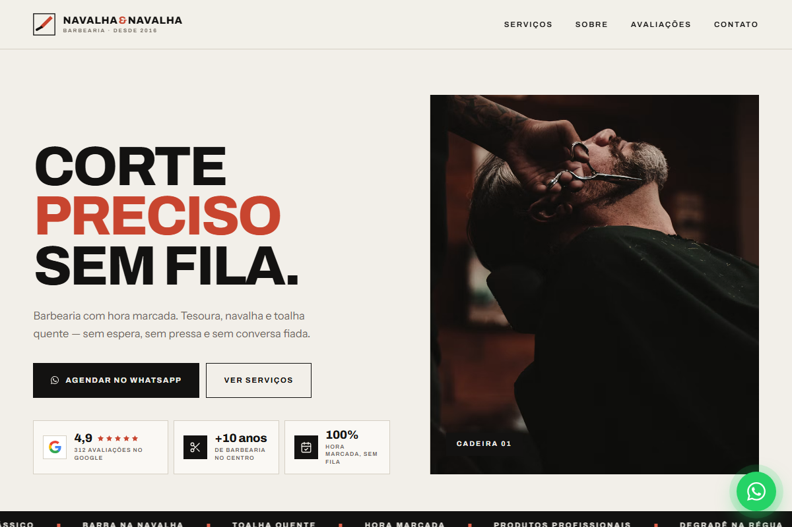
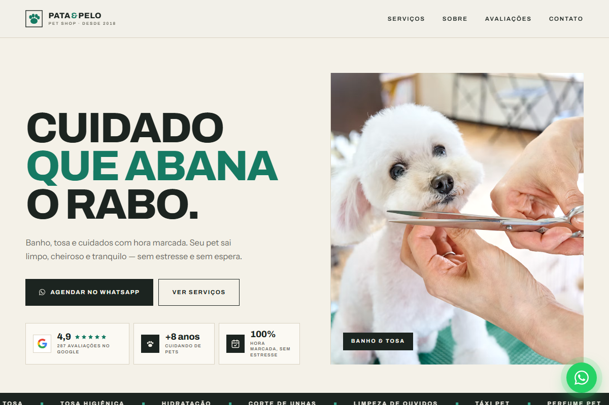
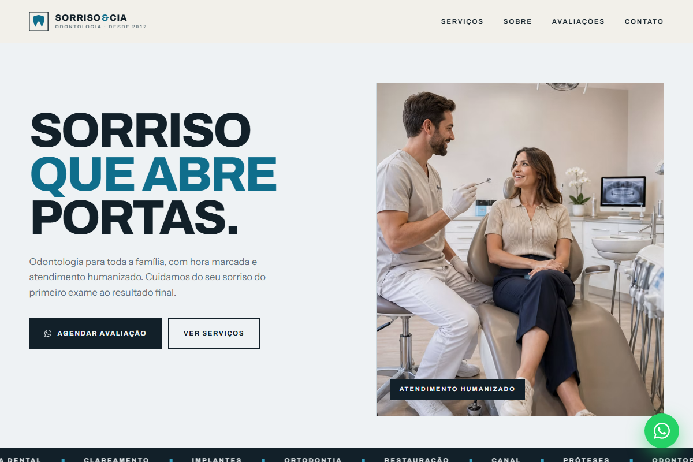

  

  

  

  
  
  

  
  
  
  

## 🚀 Sobre mim

💻 Desenvolvedor web focado em soluções modernas, escaláveis e centradas no usuário.  
🎨 Transformo ideias em experiências digitais de alta performance.  
📘 Sempre aprendendo novas tecnologias e evoluindo como profissional.

## 🛠️ Tecnologias que utilizo

  

## 📊 Estatísticas

  
  

 

  

 

  

 

  

## 🌟 Projetos em destaque

  
  
  

 

  
  
  

→ **vini-stn/vinistn** — vitrine com landing pages, delivery pizzaria interativo e e-commerce, tudo em um só portfólio.  
→ **Veja tudo em:** [vinistn.vercel.app](https://vinistn.vercel.app) · [todos os repositórios](https://github.com/vini-stn?tab=repositories)

## 🎯 Objetivo

Continuar evoluindo como desenvolvedor, contribuindo para projetos open-source e criando soluções que impactem positivamente pessoas e negócios.

  

